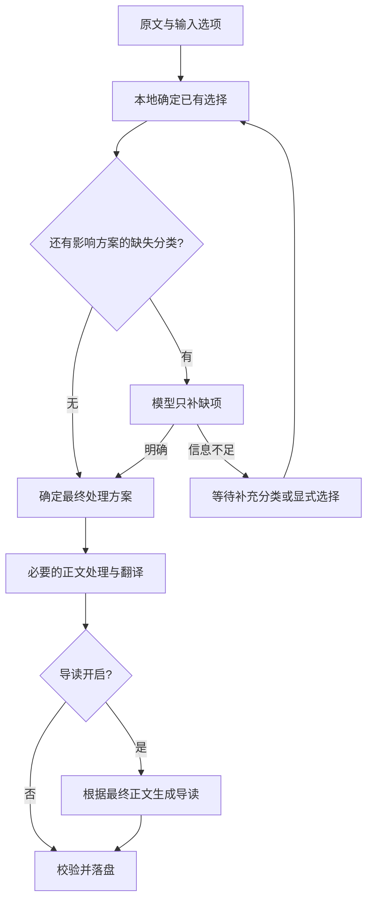

# 标准预处理：处理方案与调用边界

生效版本：处理器 `1.12.0`，接口 `1.3.0`。策略实现唯一入口为 `lib/workflow-plan.mjs`。

## 四个环节

1. **取得原文**：来源适配器负责抓取或文件解析，保留 Markdown 与来源信息。
2. **确定处理方案**：先读取人工指定的选择和类型，只对仍影响未指定选择的缺失分类调用模型。分类不足返回 `needs_classification`，不生产或发布阅读文件。
3. **执行必要步骤**：全文口语转书面或显式“强结构化整理” → 可选翻译 → 可选最终导读。已是书面 Markdown 时，默认本地规范化；导读只读最终正文，不能再次改写正文。
4. **校验和落盘**：要求翻译就必须生成译文，要求导读就必须生成导读。缺失时只保留内部来源、已完成阶段和失败记录，不发布到阅读区。英文比例、单块是否含中文、导读字数、洞察数量和表达风格不作为重试或发布门槛；非空产物、来源覆盖、受保护格式、结构字段和有效跳转仍须成立。

PDF/MinerU 来源适配器在预处理之前，默认用本地脚本建立逐页文本层对照，核验文字覆盖、数字候选、OCR 到 Markdown 映射和可疑代码标记。该检查不调用模型；疑点只进入来源审计，不增加翻译、导读、分类或模型复核次数，审计信息不进入生产请求或阅读正文。既有材料补审计时复用原件和已有 OCR，不重跑已完成阶段。详见 [PDF 文本层自动对照](../../rich-text-import/README.md#pdf-文本层自动对照)。

### 中文字形规范

所有标准路径在共享发布环节以 OpenCC `t2s` 机械转换可读文本中的繁体中文，包括标题、正文、导读、中文引文及附后的原文展示；英文保持不变。不调用模型执行繁转简，不借字形转换改写词义、润色或删减。实现唯一入口为 `lib/chinese-script.mjs`。

文学 EPUB 的直接发布入口通过 `chinese-script-cli.mjs` 调用同一个转换器，也遵守该规范；直接出版不意味着生成翻译或导读。转换器采用 OpenCC 通用繁简字形配置，不额外替换地区用语。

原始 PDF、抽取 Markdown、请求、模型产物和来源哈希保持原样，阅读文件是简体展示投影。代码、公式、URL、图片或文件目的路径、内部链接目标及身份元数据逐字保护；内部链接可增加简体显示别名。`publication.json.chinese_script` 记录转换配置和实际变化字符数。验收原文覆盖时，应比较来源经过同一机械字形投影后的可读文本，并另核对原始来源哈希，不把预期字形差异误报为内容丢失。

发布层同时通过 `lib/reader-math.mjs` 把 `\(...\)` 与 `\[...\]` 的数学显示分隔符分别转为 `$...$` 与 `$$...$$`，使实际阅读器能够渲染。仅改分隔符，公式内部逐字不变；代码、Mermaid、已有原生公式和文件目的路径不参与转换。来源、模型响应与正文审计保留原样，`publication.json.math_delimiters` 记录转换数量。



## 选择的优先级

`processing_options` 中每个显式布尔值优先于类型默认值。未指定和 `false` 是两种状态；界面“自动”对应省略字段。请求中的分类优先于来源元数据；已有分类不交给模型重新判断。

| 选项 | 未指定时的默认规则 |
| --- | --- |
| `spoken_to_written` | 仅口述转写 `spoken_transcript` 开启；完整原文一次转为连贯书面段落，不强制大纲 |
| `structure_body` | 关闭；明确有强结构化需求时开启“强结构化整理”，字幕和文字资料都适用；开启后取代普通口语整理，不连续改写两遍 |
| `translate` | 仅英文 `en` 开启；中文、已双语和其他语言默认关闭 |
| `include_reading_guide` | 普通文章、技术文章 `natural_language` 开启；数理讲义 `math_lecture`、文学 `literature` 关闭 |

分类字段为 `input_form`、`content_profile`、`source_language`；来源元数据的语言字段为 `language`。文学指小说、诗歌、戏剧、文学性散文，不因标题含 essay 就将论说或技术文章判为文学。

视频来源另有适配层可选项 **图文模式**，仅当用户明确声明本次或本批开启时通过 VideoBook 入口传 `--type illustrated`（或 `--type 图文模式`）。默认关闭，`structure_body:true` 本身不会开启截图或 Mermaid 生成，也不因上一份视频开启而沿用。它复用上游媒体流程、强结构化正文和本标准处理器；操作演示的截图时机与实图核对见 [视频图文模式](../../video-workflow/README.md#截图时机与实图核对)。该选择属于视频获取与合并层，不混入文字资料的自动分类。

2026-10-06：两种正文方式共用 `lib/full-text-body.mjs` 与 `refine-full-text.py`，先完成全文正文，再进入原有翻译、导读和发布流程。`plan.body_mode` 记录本次实际采用 `preserve / spoken_to_written / strong_structuring`，与来源网站无关。

- **强结构化整理**：[同名提示词](../prompts/强结构化整理.md)与 AudioWorkflow 的原 `prompts/refine.md` 对齐。显式选择此模式后直接整理完整字幕或文字资料，按原规则清理口语、合并重复并重组层级。
- **全文口语转书面**：[提示词](../prompts/spoken-to-written-fulltext-v1.md)保留原无损书面化的观点、例子、数字、限定、视角与保护语法要求，将全文一次输入，输出连贯段落。信息无损不等于逐字保留口语，需要重组句子、理顺指代并去掉现场互动。必须按内容生成 `##` / `###` 小标题，原有准确标题可以保留；不要求多层项目符号。响应缺少小标题时保存失败现场，不自动重跑。
- 已有稿件仅缺少标题时，可用 `lib/restore-content-headings.mjs` 根据同一材料已有标题及顺序一致的文字证据做本地格式修复；无法确定位置的标题不猜放。只插入标题，逐字符验证其余正文不变，记录修复前后哈希，不调用模型。
- 两者复用 AudioWorkflow 的单次非思考调用；强结构化同时复用原 `AI.outline_call`。代码、Mermaid、公式和文件引用以确定性标记保护并原位恢复，丢失标记时停止，不自动重生。
- `receipt.body_refinement` 保存模式、提示词哈希、完整输入与响应哈希、调用数及审核状态。正文来源关系为“完整原文 → 单份正文”，不把新正文段落伪称为字幕逐段映射。语义最终验收由用户进行。

明确指定全部选择后，分类调用为零，包括全部开启的情况。执行翻译时，若已有 `math_lecture` 标签，使用数理翻译路径；没有类型且选择已明确时使用通用保真翻译，不再为了选择开关而追问分类。

示例：文学材料默认不生成导读，但本次明确开启导读；翻译仍按语言决定：

```json
{
  "workflow_mode": "standard",
  "content_profile": "literature",
  "include_reading_guide": true
}
```

只保存本地规范化原文、完全不调用模型：

```json
{
  "workflow_mode": "standard",
  "spoken_to_written": false,
  "structure_body": false,
  "translate": false,
  "include_reading_guide": false
}
```

## 关闭导读的含义

2026-09-30 用户确认：审核只检查实际生成与基本结构，不追加文风评分。失败回退的原文不是译文，待生成说明不是导读。`lib/required-artifacts.mjs` 是各发布入口共用的必需产物检查，`scripts/standard-import-quality.mjs` 只在此检查通过后判断可读警告。

- 所有正文和翻译阶段都禁用导读，最终导读阶段直接跳过。
- 当次结果的 `artifacts.semantic.judgments` 为 `null`，`insights` 为 `[]`；不产生导读卡，也不把已生成内容隐藏。
- 生产器在禁用阶段返回导读数据会被拒绝。渲染器也拒绝隐藏非空导读数据。
- `receipt.reading_guide` 记录 `skipped / generated / failed`、决定来源、原因和当次调用次数。

## 模型调用与复用

- 人工信息足够时，方案确定为零调用；书面材料的默认规范化为零调用。
- 只有启用的正文处理、翻译和导读步骤才生产内容。全文正文只发送一次；响应中断、截断或格式失败保留现场，禁止自动重发。已有完整响应仅本地复用，不重新生成。
- 全文正文之后的正式导读只使用 Codex Exec，共用 `guide-coverage/v2` 与 `guide-fidelity/v1`。先依据原文建立证据清单并区分作者观点、引述、被反驳观点、假设和疑问，由程序绑定原句片段、生成稳定 ID 并冻结。分段生成、补漏、删重、覆盖和保真核验始终携带全文语境；补漏保留完整原段落，不将孤立引语误当作作者结论。
- 洞察允许摘取原句或忠实改写，只表达原文观点。数量、量词、条件、因果、否定与判断力度保持原意，不额外增加边界、免责声明、平衡意见或解释。原文已有的限定和反驳继续保留。阅读价值等 judgments 仍按既有规则单独给出，不混入核心洞察。
- 覆盖核验只返回冻结 point_id 对应的洞察序号与具体漏项，不改写信息点。保真核验按全文证据逐条检查洞察及跳转，逐字回写标题与跳转 key，防止相邻卡片串位；声称 supported 却未提供该跳转块依据的矛盾响应先修审计，不直接用于改写卡片。真正不支持的命题必须修复后复核，不能只作提示放行。局部修正同时携带相关冻结信息点，并保留图注、图表、引语或脚注的来源身份，不能通过删去原文信息来消除审计冲突。每次结构响应最多校正一次，反馈包含上一轮输出和具体错误位置。覆盖核验最多三轮，每轮候选的每条洞察最多修正两次，修正后必须重新核验；后来首次发现的问题和补漏新增的洞察都有独立机会。仍失败则保留现场并停止发布。正文和原始强结构化提示词不参与这一修复，不追加文风评分。
- 整篇洞察数量由来源信息量决定，单次提取的条数预算不限制整篇汇总。分段缓存覆盖输入、选项、模型、后端、传输及覆盖版本；已完成生成和核对可复用，信息点清单不能随重试漂移。
- 同一洞察两次局部修正后若仍存在审计异议，停止改写，仅增加一次独立的原文证据复核。复核只判断异议是否成立，不修改卡片；真实差异仍未解决则停止发布。标题概括了描述中的多个相关命题、同一段多句共同支撑内容，或审计要求改到当前已有的 key，均不能单独作为不保真的理由。复核记录争议数与有证据撤销的误报数，仍使用统一 Codex Exec 路由。
- 整篇删重、保真和覆盖核验使用各自的任务范围，不继承“只为当前分段生成”的限制；所有输入洞察及其跳转都在核对范围内。同一命题出现在多个来源块时，可由同一条忠实洞察覆盖。删除项必须说明被哪些保留项完整承载，不能引用已删除项。导读的提取、补漏和审计通过 Codex Exec 原生 `--output-schema` 限制字段和合法编号，本地继续核验完整分配、删除依据和原文保真。覆盖核验使用程序分配的短编号，结束后映射回冻结 ID，避免模型抄写长哈希造成编号错误。结构化输出约束只用于导读，正文调用不带此参数；已有通过语义校验的阶段缓存仍可复用，原始响应缓存单独绑定结构约束。
- 翻译长文可按必要片段调用；数理翻译可包含术语盘点。校验失败的定点修复仍会增加调用次数，不能把“一个阶段”宣传成恒定一次 API 调用。
- 分类、正文、翻译、导读分别缓存。缓存键覆盖输入、处理选项、版本和相关提示词。切换导读开关不重做已完成的翻译；导读失败后可复用正文再试导读。
- 浏览器适配器不再进行三轮整条工作流重试。网络传输重试与模型阶段重试分别记录。
- `receipt.model.calls`、`call_ledger` 和 `workflow_route.stages` 均表示当次实际执行；缓存重放为零调用。

## 输入与恢复入口

- `/import` 页面：输入链接时可指定分类与每项“自动 / 开启 / 关闭”。等待分类时修改这些选择，点击该条结果的“使用当前分类与处理选择继续”。
- URL API：`POST /api/browser-import/requests`、兼容入口 `/api/highlights/import-local-urls` 接收 `processing_options`。浏览器正文入口 `/api/highlights/import-local` 也接收同一字段。
- 恢复：`POST /api/browser-import/requests/:id/classification`，正文为 `{ "processing_options": { ... }, "urls": [ ... ] }`；`urls` 可省略。只恢复等待输入的条目；已完成文章和冻结原文继续复用。
- 批量回执：`awaiting_input: true` 与 `status: needs_classification` 表示未完成。兼容字段 `terminal: true` 只表示本轮自动执行停止，不代表导入完成。
- CLI：在 request JSON 中填写 `processing_options`；`needs_classification` 的退出码为 `3`。补充同一请求后重新运行，使用相同缓存与审计目录。
- 旧网页 / 微信命令：`scripts/import-web-md.mjs --processing-options <JSON 文件>`，也进入共享标准接口，已移除独立的补标题和导读生产器。
- 历史的 `single_stage` 接口保留作底层兼容；新导入必须选择 `workflow_mode: standard` 或调用 `standardWorkflowOptions()`。

## 验收证据

2026-09-28：单元与合同回归、真实本地 HTTP 导入、页面状态恢复及批量恢复已覆盖。真实 DeepSeek API 使用公开 Graham 原文和独立文学样例验证；审计位于 `D:\Artifacts\ProgressiveReading\processing-plan-repair-20260928`。测试未改写已有阅读区文章。
